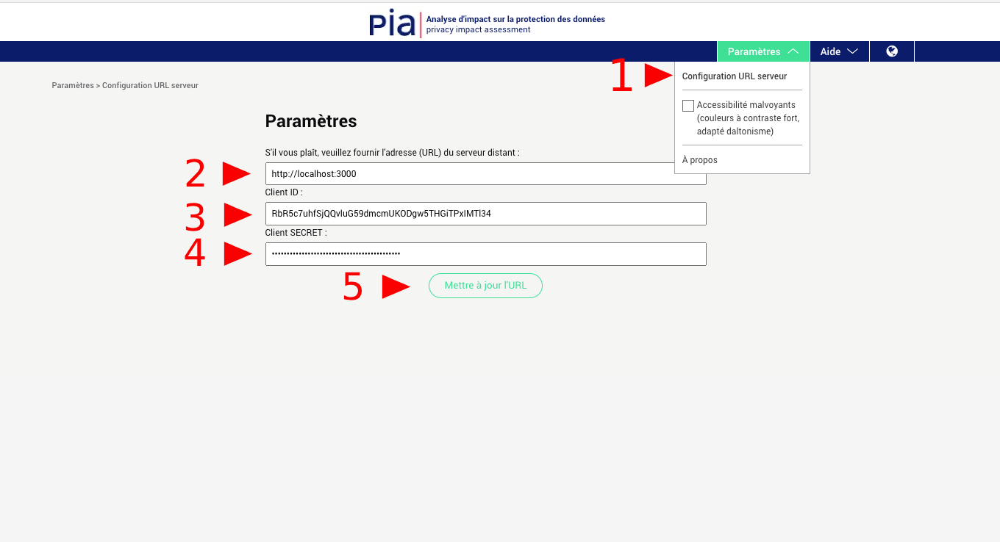

# Le logiciel PIA / The PIA Software
 Le logiciel PIA est un outil distribué librement par la [CNIL](https://www.cnil.fr/fr/outil-pia-telechargez-et-installez-le-logiciel-de-la-cnil) afin de faciliter la réalisation d’analyses d’impact sur la protection des données prévues par le RGPD.
PIA-BACK est développé avec le framework RubyOnRails mettant à disposition une API RESTful à destination des outils PIA et PIA-APP.

The PIA software is a free tool published by the [CNIL](https://www.cnil.fr/en/open-source-pia-software-helps-carry-out-data-protection-impact-assesment) which aims to help data controllers build and demonstrate compliance to the GDPR.
PIA-BACK is developped with RubyOnRails providing a RESTful API for the PIA and PIA-APP applications.

[](https://github.com/LINCnil/pia-back/actions/workflows/ci.yml)
[](https://github.com/LINCnil/pia-back/actions/workflows/codeql-analysis.yml)
[](https://www.codefactor.io/repository/github/lincnil/pia-back)
[](https://github.com/rubocop/rubocop-rails)
[](https://rails.rubystyle.guide)

## Wiki for a production environment
**You can follow [the wiki](https://github.com/LINCnil/pia-back/wiki) for a full production installation of the `pia` (frontend) and `pia-back` (backend) applications on an Ubuntu server.**

## Requirements
- [pia (front-end) application](https://github.com/LINCnil/pia)
- [Ruby](http://www.ruby-lang.org) 3.4.x
- [Rails](http://rubyonrails.org) 8.0.x
- [PostgreSQL](https://www.postgresql.org) 13+

## System requirements
- CPU : i5
- Ram: 4Go
- Disk Space : 20Go
- OS : preferably Linux but other OS works as well

# Ruby installation
See the [Install Ruby](https://github.com/LINCnil/pia-back/wiki/Install-ruby) page in the Wiki.

## PostgreSQL installation
See the [Install PostgreSQL](https://github.com/LINCnil/pia-back/wiki/Install-PostgreSQL) page in the Wiki.

## Run the application in a development environment
- `bin/rails s` your server will be accessible with the URL `localhost:3000`

- You can specify the option `-b` to bind to a public IP address or domain name and `-p` to use a different port.

    For example: `bin/rails s -b 123.456.789.101 -p 8080` your server will be accessible with the URL `123.456.789.101:8080`

- Then, in [the pia (front-end) application](https://github.com/LINCnil/pia), use this URL to enable the server mode.

- Fill the field in "Tools" > "Settings"

- Every user will have to fill the server URL, the client ID and the client SECRET fields to access the authentication interface.



## LDAP authentication

Configure the LDAP server for each environment in `config/ldap.yml`. Development
reads `ldap_host`, `ldap_port`, `ldap_attribute`, `ldap_base`, `ldap_admin_user`,
`ldap_admin_user_password` and `ldap_ssl` from Rails credentials.

- Set `DEVISE_LDAP_LOGGER` to any non-empty value to enable LDAP authentication.
  For compatibility, even the string `false` enables it; this variable no longer
  controls debug logging.
- Set `DEVISE_LDAP_LOGGER_ADMIN_BIND` to use the configured admin credentials
  for directory searches. Any defined value, including an empty string, enables
  the admin bind. Leave the variable unset for anonymous searches.
- Set `ssl` to `simple_tls` (or `true`) for LDAPS, or `start_tls` for StartTLS.
  The server certificate and hostname are verified using the system trust store.
  An unset or false `ssl` retains legacy plaintext LDAP behavior and logs a
  warning: credentials will be transmitted without encryption.

For a private CA, configure `encryption`, which takes precedence over `ssl`:

```yaml
encryption:
  method: start_tls
  tls_options:
    ca_file: /path/to/ldap-ca.pem
```

The login is searched using the configured attribute. If the search returns no
user, or anonymous binding or searching is refused, authentication also tries
the legacy DN format `attribute=login,base`. A successful first LDAP login
creates a local user with the LDAP `mail` attribute, or the login when no email
is available. If LDAP rejects the credentials, existing local email/password
authentication remains available. LDAP connection, configuration, and
ambiguous-search errors do not fall back to local authentication.

The previous LDAP group and attribute authorization checks were disabled in
this application and are not implemented. An LDAP configuration that explicitly
enables group checks is rejected rather than silently bypassing them. LDAP
password changes are not performed by this application.

## How to update to the latest version in a development environment

Go to the folder pia-back : `cd pia-back`

Update the repository : `git pull`

Update the dependencies : `bundle install`

Update the database : `bin/rake db:migrate`

## Rails 8 - How to migrate your attachments from Carrierwave to ActiveStorage

This migration utility converts file attachments from the legacy Carrierwave storage system to Rails' ActiveStorage.
Note that this migration only works for locally stored files and requires the correct file structure within the data/attachment/attached_file/ directory.

`RAILS_ENV=production bin/rake active_storage_migration`
